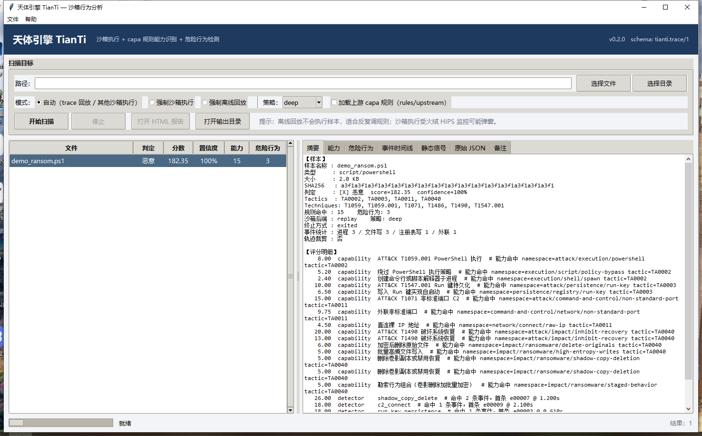

# 天体引擎 / TianTi

沙箱行为分析型杀毒引擎（全新模式）：**沙箱执行 + capa 规则识别能力 + 危险行为检测**。
不做特征码比对，只看文件「跑起来做了什么」。

## 状态

| 里程碑 | 内容 | 状态 |
|--------|------|------|
| M0 | 地基与契约（Trace / SandboxBackend / RuleMatch+DetectorHit / Verdict） | 完成 |
| M1 | 静态预筛（PE/脚本/归档/熵/加壳启发） | 完成 |
| M2 | 归一化 + 回放后端 | 完成 |
| M3 | containment 沙箱（隔离 + 观测） | 完成（ETW 默认关闭） |
| M4 | capa 兼容规则引擎 + 54 条规则 | 完成 |
| M5 | 危险行为检测器 + 评分判定 | 完成（26 检测器） |
| M6 | CLI / HTML 报告 / 本地 API | 完成 |
| M7 | 评测与加固 | 完成（perf 有已知差距，见下） |

计划全文见 [docs/PLAN.md](docs/PLAN.md)，评分/抑制语义见 [docs/SCORING.md](docs/SCORING.md)，Trace 契约见 [docs/TRACE_SCHEMA.md](docs/TRACE_SCHEMA.md)。

## 常用命令

```powershell
$PY = "$env:USERPROFILE\.dsh\dsh-runtimes\dsh-primary-runtime\dependencies\python\python.exe"

# 版本与环境自检（会显示 backends 可用性）
& $PY -m tianti version --check

# 回放一份行为轨迹：capa 能力 + 危险行为 + 评分判定
& $PY -m tianti replay tests\fixtures\traces\golden_ransom_sim.json --format summary

# 生成 HTML 报告
& $PY -m tianti replay tests\fixtures\traces\golden_ransom_sim.json --out out\demo
& $PY -m tianti report out\demo\result.json --out out\demo\report.html

# 真实扫描（管理员：containment 沙箱执行；非管理员：回退 replay 并在 notes 标注）
& $PY -m tianti scan samples\sim\hello.ps1 --policy deep --format both --out out\scan

# 上游 capa 规则（默认关闭，rules/upstream/ 625 条）
& $PY -m tianti rules validate --include-upstream
& $PY -m tianti replay tests\fixtures\traces\golden_ransom_sim.json --include-upstream --format summary

# CAPE 报告 -> 行为轨迹（让 api 级上游规则可离线回放）
& $PY -m tianti convert-cape report.json --out trace.json

# 规则/检测器管理
& $PY -m tianti rules validate
& $PY -m tianti rules match tests\fixtures\traces\golden_injection.json
& $PY -m tianti detectors list

# 本地 API（仅 127.0.0.1）
& $PY -m tianti serve --port 8765
```

## 御天分析（Tk 桌面前端）



```powershell
& $PY -m tianti gui                 # 启动图形界面
& $PY -m tianti gui --demo          # 加载 golden trace 演示
& $PY -m tianti gui --smoke         # 无交互自检
```

「御天分析」是桌面前端（内核 TianTi，入口 `tianti gui`）。纯标准库 tkinter 实现，复用同一套 pipeline：选择文件/目录 → 自动判断（trace JSON 离线回放 / 其他文件沙箱执行）
→ 结果表 + **批量汇总矩阵**（可导出 CSV）+ 能力/危险行为/时间线/原始 JSON 详情 → 一键生成 HTML 报告。
扫描可随时「停止」并**强杀当前沙箱进程树**。离线回放不执行样本，也不会触发火绒。
详见 [docs/GUI.md](docs/GUI.md)。

## 当前能力

- 静态预筛：PE32/PE64 结构、节区熵、导入/导出、签名目录存在性、overlay、加壳启发；脚本/归档特征；**Office 宏提取**（OOXML/OLE、CFB 解析、宏/自动执行/可疑 API 信号）；EICAR 识别（不执行）。
- 压缩包：zip 安全展开、逐条目静态分析、聚合判定（CLI/GUI/HTML 展示条目表，有 100 条/64MB 上限）。
- 沙箱：containment 后端（受限令牌 + 低完整性 + Job Object + 按程序防火墙 + 超时硬杀 + 进程树清理），事件覆盖 process/file/network/registry；replay 后端用于 CI 与离线分析。
- capa 兼容规则引擎：and/or/not/optional/count/match（DAG）、5 种 scope、54 条自研规则 + 可选 625 条官方上游规则（`--include-upstream`）。
- 危险行为检测：26 条 YAML 检测器（时序 + 聚合 + 序列），覆盖 10 个 ATT&CK 战术。
- 判定：分数/置信度/证据链/抑制明细，clean/suspicious/malicious 三档。
- 交付：CLI、Tk 桌面前端、单文件 HTML 报告、本地 HTTP API。

## 支持的输入

| 输入 | 处理方式 |
|------|----------|
| PE32 / PE64：`.exe`（以及无扩展名 PE） | 静态预筛 + **沙箱动态执行**，产出行为轨迹 |
| PowerShell `.ps1` / 批处理 `.bat` `.cmd` / JScript `.js` / VBScript `.vbs` | 静态预筛 + **脚本宿主执行**（powershell/cmd/cscript） |
| DLL/SYS/OCX/CPL/SCR、压缩包（zip/rar/7z）、Office（doc/docx/xls/xlsx/ppt/pptx）、PDF、文本/Markdown/JSON、图片等 | **仅静态分析**（不执行，产出类型/哈希/信号/嵌入物检测，结论置信度相应降低） |
| `tianti.trace/1` 轨迹 JSON | **离线回放**（不执行） |
| CAPE / capa 动态报告 JSON | 先 `convert-cape` 转轨迹，再按轨迹分析（可命中 api 级上游规则） |

沙箱执行类型与 containment 启动器能力一致：遇到不能执行的文件不会尝试启动，而是自动回落到静态分析并在结果 notes 中标明。

## 已知限制

- 本机无虚拟化：containment 是「受限执行」而非 VM 隔离，只跑无害样本；真实恶意样本需独立 VM。
- 低完整性限制写入（含 C:\Windows），不限制读取/执行；按程序防火墙不覆盖样本拉起的其他 exe 外联。
- ETW 可用但实测开销大（单样本 stop+tracerpt 约 97s、XML 450MB），默认关闭；如需开启用 ContainmentBackend(use_etw=True)。
- 签名校验为占位（基于可信路径），非证书链验证，报告会标注。
- 单进程串行扫描，目录最多 200 个文件。
- 本机 360 HIPS 可能删除包含高密度恶意命令字符串的测试 .py 文件，写测试后请校验文件存在。


## 验收结果（2026-10-24）

| 项 | 结果 |
|----|------|
| 全量测试 | 290 tests OK（0 失败 0 跳过，约 65s；含 5 个沙箱红线用例） |
| golden 判定 | ransom malicious 182.35 / injection malicious 107.6 / benign suspicious 15.0（<40） |
| 规则包 | 54 条（capa 格式），lint 0 error / 0 unsupported |
| 检测器 | 26 条，覆盖 10 个 ATT&CK 战术 |
| 性能（10k 合成事件） | rules 591ms（目标 300ms，约 2x）、detect 1353ms、scoring 25ms、CLI replay 2k 端到端 955ms |
| 沙箱隔离 | 受限令牌 + 低完整性 + Job Object + 防火墙；写系统目录被拒、断网生效、超时杀树、无残留 |
| 残留审计 | 无 tianti 进程 / 防火墙规则 / 临时目录 |

性能差距说明：rules 10k 的 591ms 主要花在 string 特征的线性正则扫描（正则无法倒排）；
detect 已从 9.5s/1k 优化到 142ms/1k（窗口剪枝 + 编译期 hints + 加载缓存）。

## 打包（便携版）

生成无需安装 Python 的便携版（PyInstaller，GUI + CLI 双入口，规则/检测器/配置随包）：

```powershell
python -m venv .build-venv
.\.build-venv\Scripts\python.exe -m pip install --trusted-host pypi.org --trusted-host files.pythonhosted.org pyinstaller
powershell -ExecutionPolicy Bypass -File scripts\build_portable.ps1 -Version 0.3.0
```

产物：`dist\御天分析-0.3.0-便携版.zip`

- `御天分析.exe`（GUI）、`tianti.exe`（CLI）、`rules/`、`detectors/`、`config/`、`docs/`、golden trace 演示数据、`启动御天分析.bat`；
- 解压后双击 `启动御天分析.bat` 或 `御天分析.exe` 即可，无需 Python；
- 只想要源码包（目标机有 Python 3.12）：`scripts\build_source_zip.ps1` → `dist\御天分析-0.3.0-源码包.zip`。

## 实验代码（未接入）

- **DLL 动态加载**：`tianti/sandbox/containment.py` 里有 rundll32/regsvr32 启动分支与单测，但
  **不接入 pipeline/CLI/GUI**（`dynamically_executable` 明确把 DLL 排除）。原因：rundll32 用任意导出调用 DLL 会崩溃，
  实测伴随 explorer 崩溃循环；保留代码供后续用专门 loader 进程替代时参考。

## 技术债

- [M7] 统一 YAML 子集解析器：tianti/rules/yamlmini.py 与 tianti/detect/yamlmini.py 两份实现（语法改动需双改）。
- 本机装有火绒 HIPS：EICAR 测试串会触发其误报（已改为运行时拼接、测试不落盘）；模拟行为样本执行时可能弹窗，属预期。
- [v2] 官方 flare-capa 差分（tools/capa_diff.py）：本机网络受限，暂以自研兼容测试为准。
- 上游规则 493 条实际加载（132 条因依赖规则未导入被剪枝），且依赖 api 级轨迹；containment 默认无 API hook，需 CAPE/capa 报告回放或后续 emulation 后端。
- 内置 54 条规则当前全部 scope=process；thread/call/span/file 引擎已支持，按需补规则。
- RuleMeta 无 severity 字段：能力权重由 ATT&CK 战术推导。
- 目录扫描暂无汇总 manifest；无并发扫描。
- rules 10k 匹配约 591ms，超出 PLAN 300ms 目标（string 特征线性扫描），后续可加词级倒排。
- 沙箱 ETW 采集器已实现但默认关闭（开销大），需要时用 ContainmentBackend(use_etw=True)。


## 目录

```
tianti/       引擎包（core/trace/sandbox/rules/detect/static/api/report）
rules/        capa 格式能力规则
detectors/    危险行为检测器
samples/      无害样本（sim 模拟行为 / benign 对照 / quarantine 样本库）
tests/        单元/集成/golden trace
docs/         计划、架构、Trace 契约、规则格式、威胁模型
```

## 安全红线

- 本机只允许无害样本、EICAR（文本）与自写「模拟行为」脚本。
- 不内置、不下载真实恶意样本；沙箱默认断网、限时、强杀。
- 本项目为行为分析原型，结论不构成安全保证。

## 许可

自研代码：见仓库说明；如导入上游 capa 规则（Apache-2.0）将保留其头部与 NOTICE。
