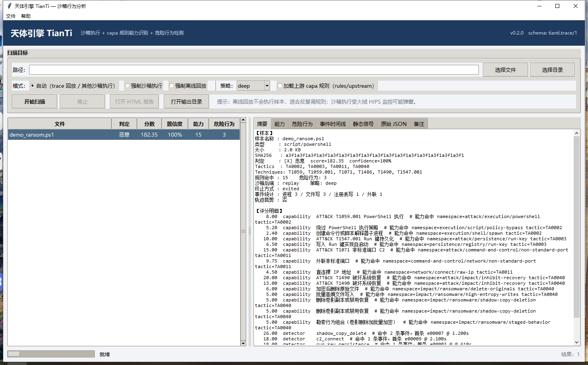

# 御天分析（Tk 桌面前端，命令 `tianti gui`）

「御天分析」是引擎的桌面前端（内核仍为 TianTi，命令行入口 `tianti gui`）。
纯标准库 tkinter/ttk 实现，复用 L5 pipeline（扫描 / 回放 / 规则 / 检测 / 评分 / 报告），
不在 UI 里重复分析逻辑。零第三方依赖。



## 启动

```powershell
$PY = "$env:USERPROFILE\.dsh\dsh-runtimes\dsh-primary-runtime\dependencies\python\python.exe"
& $PY -m tianti gui
& $PY -m tianti gui --path samples\sim\hello.ps1      # 预填路径
& $PY -m tianti gui --demo                            # 加载 golden trace 演示数据
& $PY -m tianti gui --smoke                           # 自检（创建窗口后立即退出）
& $PY -m tianti gui --demo --screenshot out\gui.png   # 渲染后截图（需要 Pillow）
```

## 功能

- **输入**：选择文件 / 目录（目录最多 100 个文件，串行分析）。
- **三种模式**：
  - 自动：输入是 `tianti.trace/1` JSON 时走**离线回放**（不执行样本），其他文件走 **containment 沙箱**；
  - 强制沙箱执行；
  - 强制离线回放。
- **策略**：fast / deep / paranoid（来自 `config/engine.json`）。
- **上游规则**：勾选后加载 `rules/upstream`（625 条官方 capa 规则，默认关闭以免影响基线）。
- **结果表**：文件 / 判定 / 分数 / 置信度 / 能力数 / 危险行为数，按判定着色。
- **汇总页**（批量结果矩阵）：扫描完成后自动切到「汇总」标签，显示总数、恶意/可疑/干净分布、平均分、能力/危险行为总数、覆盖战术，以及按分数排序的矩阵；支持「导出汇总 CSV」。
- **详情页**：摘要（样本、判定、评分明细、静态信号、备注）、能力（规则/命名空间/ATT&CK/证据数）、
  危险行为（检测器/严重度/分数/战术/技术/证据数）、事件时间线、静态信号、原始 JSON、备注。
- **导出**：一键生成 `.result.json` + `.report.html`（`out/gui/` 下）并打开。

## 设计要点

- 扫描在后台线程执行，通过 `queue.Queue` + `after(120)` 回到 UI 线程刷新，窗口不卡；
- 单文件失败不中断整批，错误显示在状态栏；
- 「停止」会**立即强杀当前沙箱进程**（`taskkill /T /F` 杀整棵进程树，Job Object KILL_ON_JOB_CLOSE 兜底），然后停止后续文件；
- 默认自动模式优先离线回放，反复调规则时不执行样本、也不会触发本机火绒 HIPS 弹窗。

## 支持哪些输入

- 动态执行：PE32/PE64 `.exe`、`.ps1`、`.bat/.cmd`、`.js`、`.vbs`；
- 仅静态：DLL/SYS（DLL 加载实验代码保留但未接入）、rar/7z、Office、PDF、文本/Markdown/JSON、图片等（不执行，自动回落静态分析并在备注标明）；
- zip 会展开逐条目静态分析（有安全上限，不执行条目）；
- 离线回放：`tianti.trace/1` 轨迹 JSON；CAPE/capa 报告先用 `convert-cape` 转轨迹。

## 扫描优化

- **仅静态分析（不执行样本）**：勾选后完全跳过沙箱，只做静态预筛 + 规则/检测/评分；
- **复用轨迹缓存**：默认开启，同一样本第二次扫描直接回放上次轨迹（不重复执行，实测 0.04s）；
- 沙箱首次执行分阶段耗时见结果 JSON 的 `trace.extra.timings`。

## 已知限制

- 只做单机本地分析，不含远程/多用户；
- 目录扫描串行、最多 100 个文件（与 CLI 的 200 上限不同，GUI 更保守）；
- 沙箱执行仍受本机无虚拟化限制（受限令牌+低完整性，不是 VM），只适合无害样本；
- 强杀可能截断当前样本的轨迹（该文件会记为失败，不会产出结果），重扫即可。
